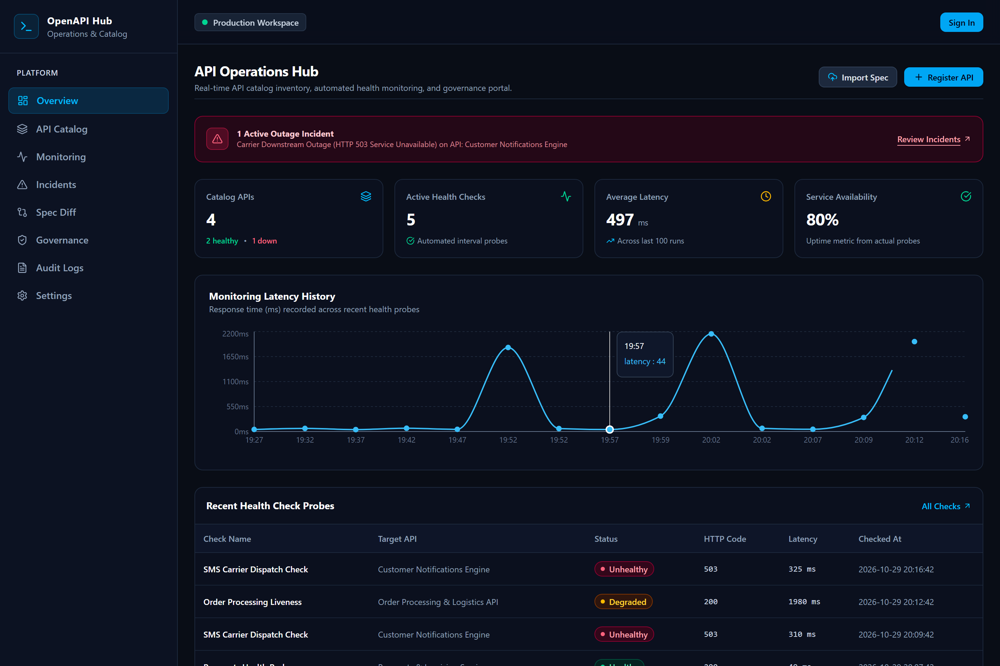
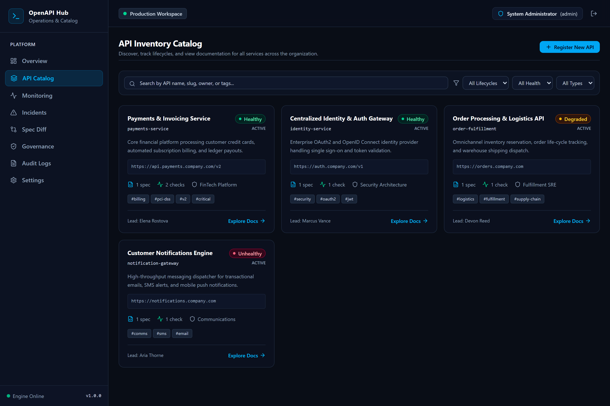
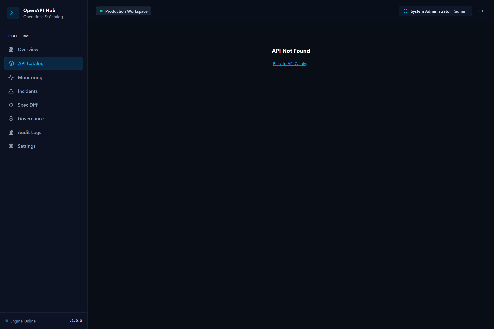
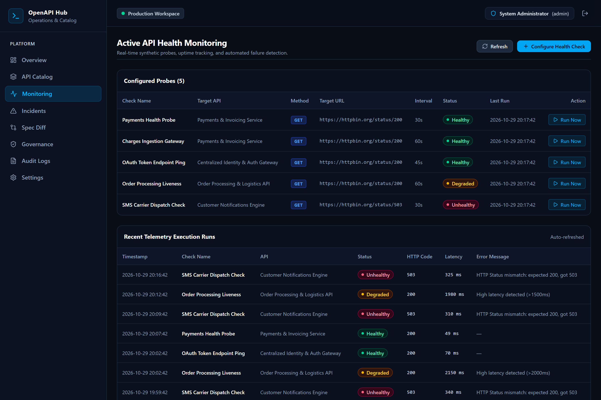
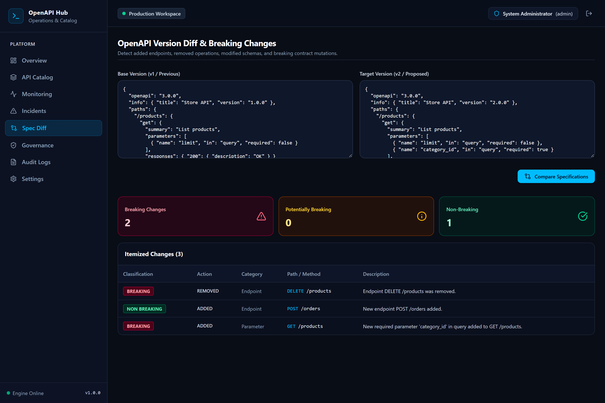
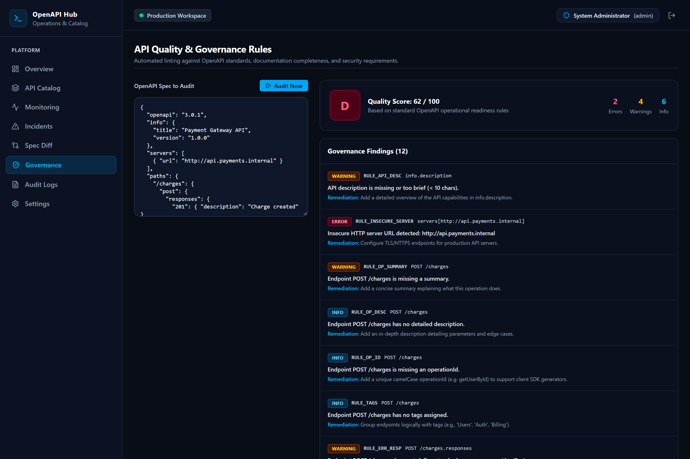
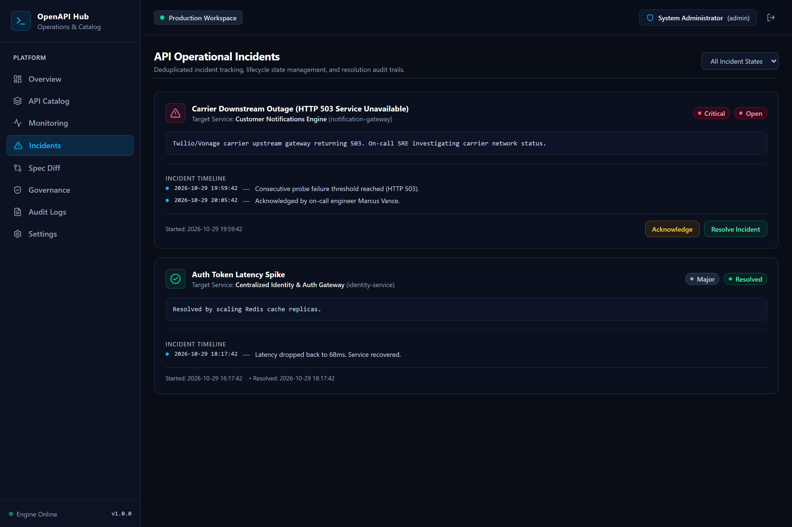
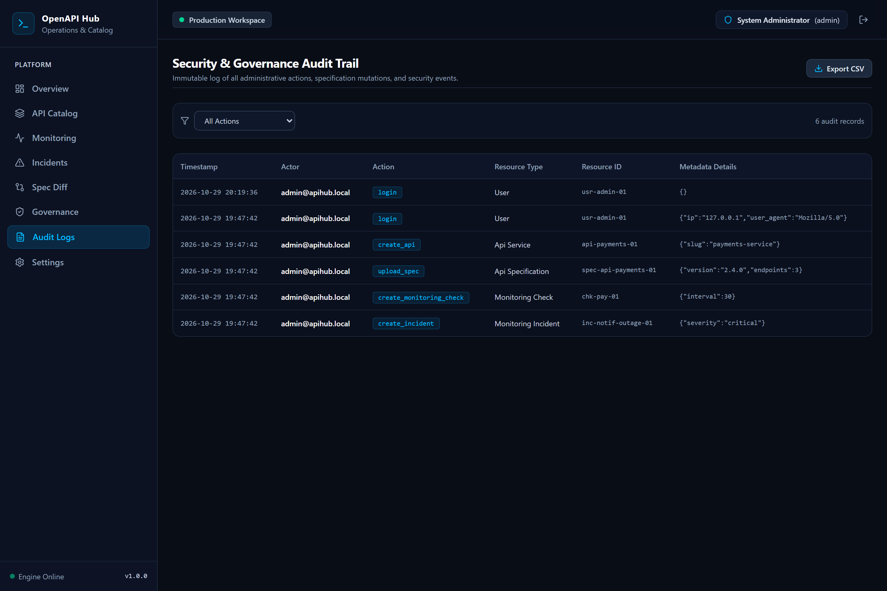

# OpenAPI Operations Hub

> **One Platform to Discover, Document, Monitor, and Manage Your APIs.**

[](https://github.com/0xyz-exe/openapi-operations-hub/actions)
[](https://opensource.org/licenses/MIT)
[](https://nodejs.org)
[](https://nextjs.org)
[-orange.svg)](https://nodejs.org/api/sqlite.html)

**OpenAPI Operations Hub** is a self-hosted, developer-first platform designed to solve API fragmentation across engineering organizations. It unifies API cataloging, interactive Swagger/OpenAPI documentation, automated synthetic health monitoring, contract breaking-change detection, and governance linting in a single deployable application.

---

## Visual Showcase & Screenshots

### 1. Operations Overview Dashboard
Unified command center tracking API health distribution, live probe latency sparklines, active outage incidents, and real-time telemetry.



---

### 2. API Catalog & Inventory
Searchable registry with lifecycle indicators (Active, Draft, Deprecated, Archived), multi-environment base URLs, ownership tags, and direct documentation links.



---

### 3. Interactive Documentation & "Try It Out" Console
Explore OpenAPI specifications, HTTP method badges, parameters, response schemas, and execute live authenticated test requests guarded by SSRF protections.



---

### 4. Active Health Monitoring & Synthetic Probes
Automated health checking engine measuring endpoint latencies, validating HTTP status codes, and persisting time-series telemetry.



---

### 5. OpenAPI Version Diff & Breaking Changes Analyzer
Semantic comparison between specification versions identifying removed endpoints, modified schemas, and added required parameters.



---

### 6. API Governance & Quality Scorecard
Deterministic linter enforcing documentation completeness, descriptions, response definitions, and TLS/HTTPS transport compliance with 0–100 quality scoring.



---

### 7. Incident Lifecycle Management
Automated incident deduplication triggering upon consecutive probe failures, with on-call acknowledgement, timeline tracking, and resolution notes.



---

### 8. Security & Compliance Audit Trail
Immutable, append-only log capturing user actions, specification uploads, probe executions, and credential events with CSV data export.



---

## Key Features

- **Centralized API Catalog**: Inventory REST, GraphQL, and gRPC services with environment routing, lead ownership, and tags.
- **OpenAPI 3.0.x / 3.1.x Registry**: JSON and YAML specification parsing, schema validation, version hashing, and changelog history.
- **Embedded Swagger Explorer**: Responsive API documentation viewer with parameters breakdown, schema definitions, and safe "Try It Out" execution.
- **Breaking-Change Detection**: Automated semantic version diffing highlighting breaking contract mutations before deployment.
- **Active Health Monitoring**: Configurable synthetic probes with latency tracking, uptime calculation, and time-series visualization.
- **Outage Incident Management**: Automated incident creation upon threshold failure, with acknowledgement and resolution workflows.
- **API Governance Scoring**: Quality rules evaluating description completeness, response coverage, and HTTPS enforcement with 0–100 quality scoring.
- **Strict SSRF Guard**: Central request filter blocking loopback, RFC 1918 private subnets, and cloud instance metadata (169.254.169.254).
- **Zero-Dependency SQLite Persistence**: Built upon Node.js 22+ native `node:sqlite` (`DatabaseSync`) with Write-Ahead Logging (WAL) for zero compilation overhead.
- **Audit Logs & Formula-Safe CSV Export**: Complete audit trail with CSV data export escaping formula injection characters.

---

## Architecture

```
┌─────────────────────────────────────────────────────────────┐
│                    Web & Desktop Browser                    │
└──────────────────────────────┬──────────────────────────────┘
                               │ HTTP / JSON
┌──────────────────────────────▼──────────────────────────────┐
│                    Next.js App Router (v16)                 │
│  - React 19 Frontend + Tailwind CSS v4                      │
│  - Route Handlers (/api/v1/...)                             │
│  - JWT Session Auth + RBAC                                  │
└──────────────┬──────────────────────────────┬───────────────┘
               │                              │
┌──────────────▼──────────────┐┌──────────────▼───────────────┐
│     Specification Engine    ││      Monitoring Engine       │
│  - JSON / YAML Parser       ││  - Synthetic Probes          │
│  - Semantic Version Diff    ││  - Latency Telemetry         │
│  - Governance Rule Evaluator││  - Auto-Incident Trigger     │
└──────────────┬──────────────┘└──────────────┬───────────────┘
               │                              │
               │   ┌──────────────────────┐   │
               └───►  Central SSRF Guard  ◄───┘
                   │  (Private IPs / AWS) │
                   └──────────────────────┘
                              │
┌─────────────────────────────▼───────────────────────────────┐
│           Persistent Storage: node:sqlite (WAL)             │
│  - Foreign Key Constraints Enabled                          │
│  - Zero C++ Compilation Dependency                         │
│  - Native DatabaseSync in Node.js 22+                       │
└─────────────────────────────────────────────────────────────┘
```

---

## Quickstart

### Prerequisites
- Node.js `22.0.0` or higher
- pnpm `12.0.0` or higher (or npm)

### Installation & Local Run
```bash
# 1. Clone repository
git clone https://github.com/0xyz-exe/openapi-operations-hub.git
cd openapi-operations-hub

# 2. Install dependencies (allow esbuild build script)
pnpm install --allow-build esbuild

# 3. Seed demo data (4 APIs, 5 health checks, 15 telemetry runs, 2 incidents)
pnpm seed

# 4. Start development server
pnpm dev
```
Open [http://localhost:3000](http://localhost:3000) in your browser.

Default credentials:
- **Email:** `admin@apihub.local`
- **Password:** `AdminSecurePassword123!`

---

## Docker Deployment

Run the complete platform with persistent storage in one command:

```bash
docker compose up -d --build
```

Health check verification:
```bash
curl http://localhost:3000/api/v1/system/health
```

---

## Automated Testing

```bash
# Run unit & integration tests (Vitest)
pnpm test

# Run production build & type checks
pnpm build

# Capture visual regression screenshots (Playwright)
npx tsx scripts/capture-screenshots.ts
```

---

## Repository Details

- **Repository:** [https://github.com/0xyz-exe/openapi-operations-hub](https://github.com/0xyz-exe/openapi-operations-hub)
- **Maintainer:** [0xyz-exe](https://github.com/0xyz-exe)
- **License:** MIT (see [LICENSE](LICENSE))
- **Default Branch:** `main`
- **Visibility:** Public
- **Clone URL:** `https://github.com/0xyz-exe/openapi-operations-hub.git`
